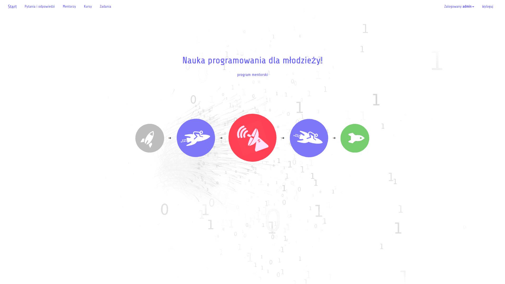
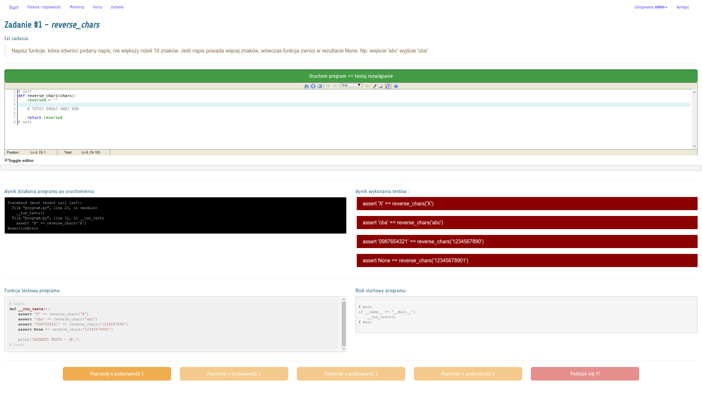
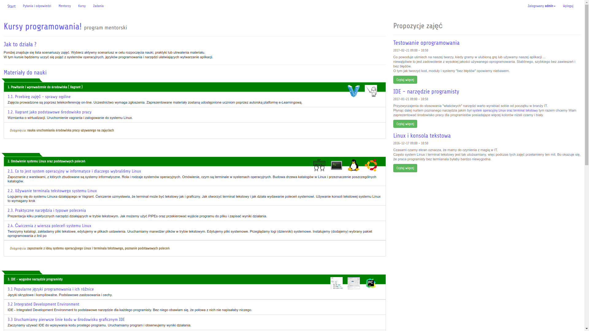
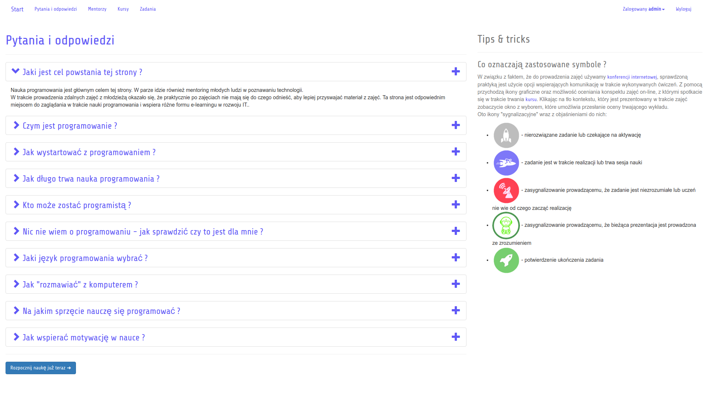
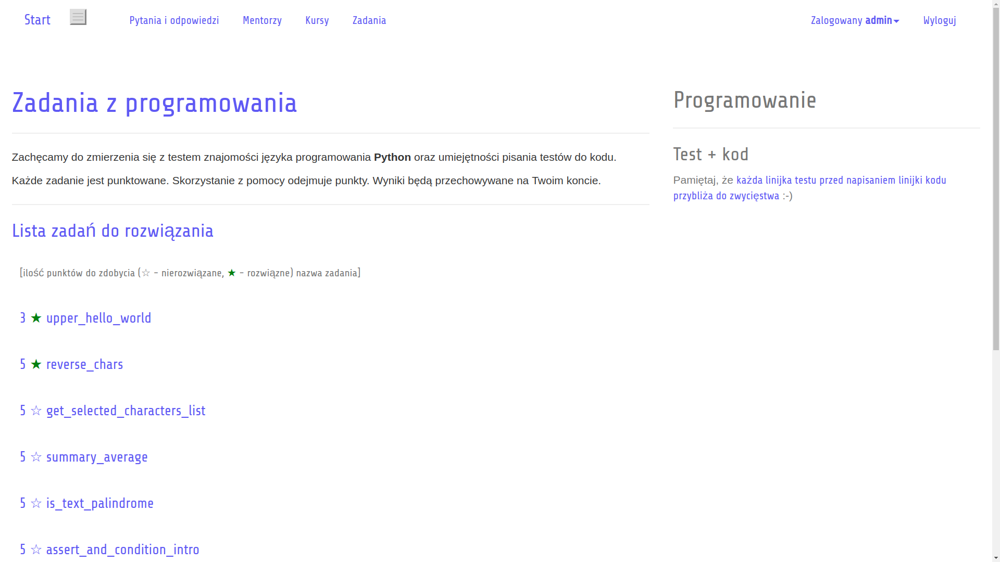
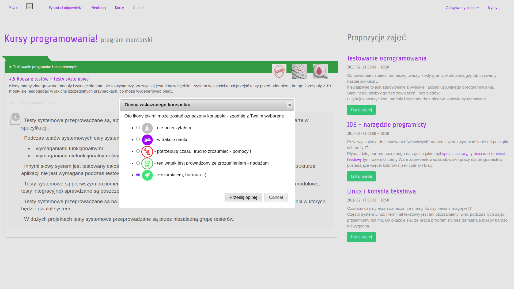

# FreeItLessons - mini e-Learning platform for IT & basic programming in Python

The mini e-Learning platform, equipped with a content management system (CMS) and remote working features, serves as an innovative solution for connecting educators with their students. Developed in response to increasing demand from students during volunteer meetings focused on programming education in schools, this project provides a dynamic and flexible environment for learning.

The platform acts as an online interface, bridging the gap between monthly in-person meetings, making education accessible beyond the confines of the traditional classroom setting. The emphasis on home working options ensures that students can engage with educational content at their own pace and convenience.

One of the project's key strengths lies in its commitment to fostering great educational values. By integrating a mini eLearning system, educators can effectively teach programming using the [Python programming language](https://python.org) through practical examples. The coding module not only includes unit tests for assessment but also provides valuable suggestions, transforming it into a comprehensive learning platform that encourages active participation and continuous improvement. With its supportive tips and interactive features, this project goes beyond a mere "code and forget" approach, enhancing the overall learning experience for students.


## Features
- Welcome page
- FAQ page (with administrator CRUD)
- Courses pages - simple CMS inside (with administrator CRUD)
- Excercies tasks with auto checking mechanism on-line in system - online course module (with administrator CRUD)
- About mentors subpage
- Students can grade/vote in course modules contents (modal window showing after click on course article - feedback loop for teachers)


### Screen shots with ready features

---


---


---


---


---


---

---

## How to run

Requirements: **Python 3.12+** (Django 6.1) or **Docker** with Docker Compose.

### Docker Compose (recommended)

```bash
docker compose up --build              # http://127.0.0.1:8000  (demo DB seeded into a volume)
docker compose run --build --rm tests  # lint + Django checks + test suite
docker compose run --rm frontend-tests # React unit tests + production build
make regression                        # legacy (Py3.7/Django 1.11) vs current: characterization check (HTTP)
make e2e                               # browser tests: jQuery UI (baseline branch) vs React UI
```

Create or reset an account inside the container:

```bash
docker compose exec web python manage.py changepassword admin
docker compose exec web python manage.py createsuperuser
```

### Development fast track (virtualenv)

```bash
make install-dev          # python3.12 -m venv .venv + dev requirements
. .venv/bin/activate
make chpwd                # optional: change "admin" user password
make frontend-install     # Node >= 22: React UI dependencies (frontend/)
make run                  # builds the React bundle, DJANGO_DEBUG=1 runserver on http://127.0.0.1:8000
make ci                   # pycodestyle + tests
```

### Configuration (environment variables)

| Variable | Default | Meaning |
|---|---|---|
| `DJANGO_SECRET_KEY` | — (**required** unless `DJANGO_DEBUG=1`) | secret key |
| `DJANGO_DEBUG` | `0` | debug mode, never enable in production |
| `DJANGO_ALLOWED_HOSTS` | `127.0.0.1,localhost` | comma separated host names |
| `DJANGO_CSRF_TRUSTED_ORIGINS` | — | e.g. `https://elearning.example.com` |
| `DJANGO_DB_PATH` | `./db.sqlite3` (`/data/db.sqlite3` in Docker) | SQLite database file |
| `DJANGO_SECURE_COOKIES`, `DJANGO_SECURE_SSL_REDIRECT`, `DJANGO_SECURE_HSTS_SECONDS`, `DJANGO_BEHIND_TLS_PROXY` | off | HTTPS hardening - enable when served over TLS |
| `CODE_RUN_TIMEOUT_SECONDS` / `CODE_RUN_MEMORY_MB` / `CODE_RUN_OUTPUT_KB` | `5` / `256` / `256` | limits of one run of a student's program |

### Upgrade notes (Python 3.12 + Django 6.1)

The project was migrated from Django 1.11 in two steps, each verified by the
characterization harness in [`regression/`](regression/README.md) (the legacy
app and the new one replay the same journeys on identical databases and the
responses + resulting data are diffed):

1. **Upgrade with behaviour parity** - framework APIs, dependencies, initial
   migration (the existing database adopts it unchanged), Docker.
   Only intended change: logout is a POST (Django 5+ dropped GET logout).
2. **Security fixes** - every intended behaviour change is listed with its reason in
   [`regression/expected_differences.json`](regression/expected_differences.json):
   * students' programs run in a restricted child interpreter (no shell, empty
     environment, timeout, CPU/memory/file/process limits, audit hook blocking
     processes, network, native code and file access); tests are always taken
     from the database, never from the browser,
   * application source code is no longer downloadable under `/static/`,
   * state changing AJAX call (content opinion) is POST + CSRF token,
   * no committed secret key, `DEBUG` off by default, HTTPS settings via env,
   * input validation (no more HTTP 500 on malformed requests), parameterized SQL,
   * scripts loaded over https only, unused third-party scripts removed.

Known limitations / recommendations: the code runner is defence in depth, not a
hardened jail - for untrusted users on the public Internet also run it in an OS
sandbox (gVisor/nsjail or a separate container without access to the database).
Students log in through the Django admin login and therefore need `is_staff`;
give them no model permissions in the admin.

### Frontend (React)

The interactive parts of the pages are React components ("islands") built with
Vite from [`frontend/`](frontend/) into `mainapp/static/mainapp/dist/`
(the Docker image builds it in a Node stage). Django still renders the pages,
URLs and contents; an element like `<div data-island="FaqAccordion"
data-props-id="faq-props">` is taken over by the component of that name, which
receives its data via `json_script`.

| Island | Page | Replaces |
|---|---|---|
| `NavBar` | every page | Bootstrap 3 JS (collapse, dropdown) + jQuery |
| `FaqAccordion` | FAQ | jQuery slide accordion |
| `RotatingStatusIcons`, `FloatingBackground` | home | jQuery animate, floating.js |
| `ContentBlock` + `OpinionDialog` | course chapter | jQuery UI dialog, jQuery AJAX |
| `TaskWorkspace` (lazy loaded) | task | edit_area, highlight.js, jquery.base64, easytimer, jQuery AJAX |
| `StatusPieChart` (`admin.js`) | admin: content statuses | jQuery + Google Charts script |

`make frontend-dev` rebuilds the bundle on every change (refresh the page).
The same Playwright spec ([`e2e/`](e2e/)) runs against the former jQuery UI and the
React UI, so feature parity is checked in a real browser (`make e2e`);
known defects of the jQuery UI are declared there as expected failures.

### How to start developing using Vagrant with Docker

1. vagrant up
2. vagrant ssh
3. vagrant > $ cd FreeItLessons
4. vagrant > $ git checkout -tb new-futer-branch origin/master
5. vagrant > $ docker build -t free-it-lessons:1.0 -f ./Dockerfile .
6. vagrant > $ docker run -p 8000:8000 -it free-it-lessons:1.0 python3 manage.py runserver 0.0.0.0:8000
7. vagrant > $ git add change-or-add-file && git commit -m "commit comment" && git push origin HEAD:new-futer-branch


### Alternative method to run Docker container from your host machine for Vagrant

```bash
ssh -o 'RequestTTY force' vagrant@127.0.0.1 -p 2222 'docker run -p 8000:8000 -it free-it-lessons:1.1 python3 manage.py runserver 0.0.0.0:8000'

...or in ~/.ssh/config:

Host vagrant
    HostName 127.0.0.1
    Port 2222
    User vagrant
    RequestTTY force
...used as:

ssh vagrant 'docker run -ti ubuntu:xenial echo hi'
```
  


## TODO:
- [x] merging first pull requests
- [x] creating README with screen shots
- [x] creating vagrant wimage (with docker container) - ready env. for other developers
- [X] update Dockerfile for Python 3.5 + instruction
- [ ] internationalization at admin and all system messages
- [ ] selecting language for website
- [ ] migration to new Bootstrap template system
- [x] JavaScript move from jQuery to EcmaScript or VueJS, etc. (React)
- [ ] change font sizes into proportional to screen (currently are too small for eyes)
- [ ] add leader boards (some interesting features for all class mates - challenges for clasess, etc)
- [x] switch to newest Django version + upgrade django components
- [x] upgrade packages & fixes for interesting SEC. issues :-)
- [ ] describe screen shots
- [ ] more information about features (maybe youtube video !)
- [ ] refactoring tasks in dedicated modules with unit tests
- [x] add unit tests and CI (GitHub Actions)

