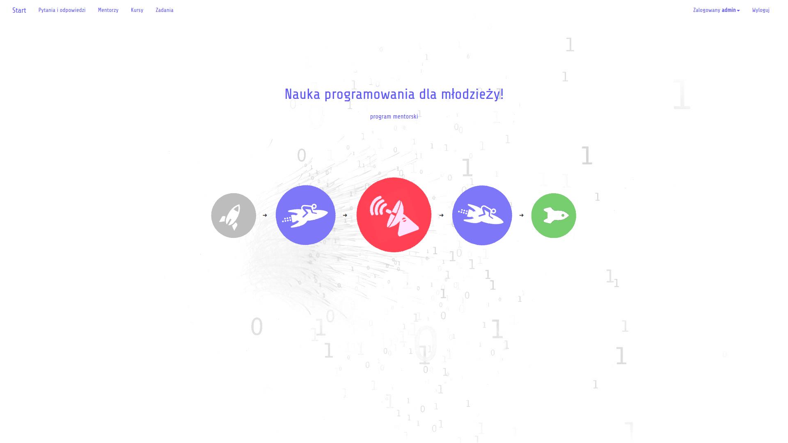
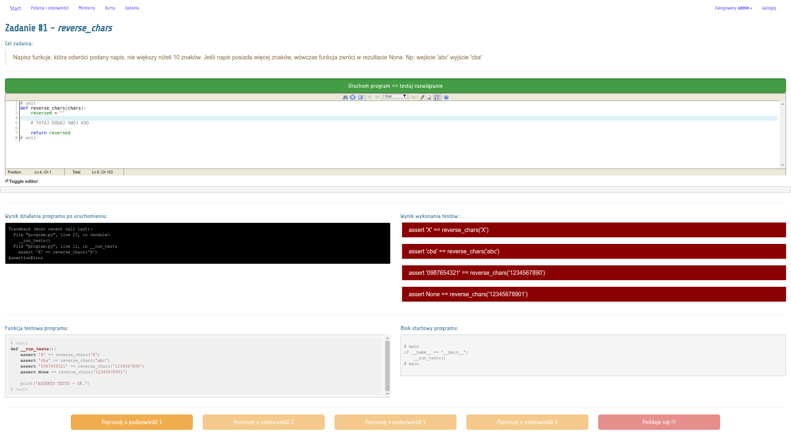
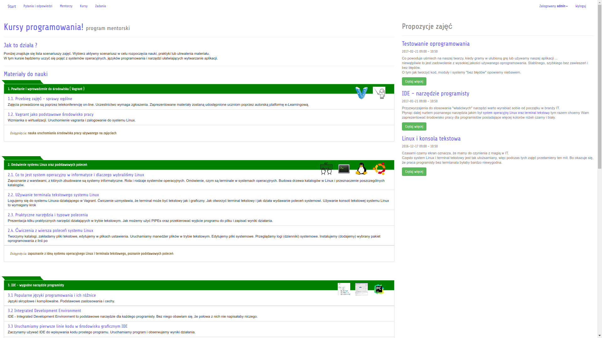
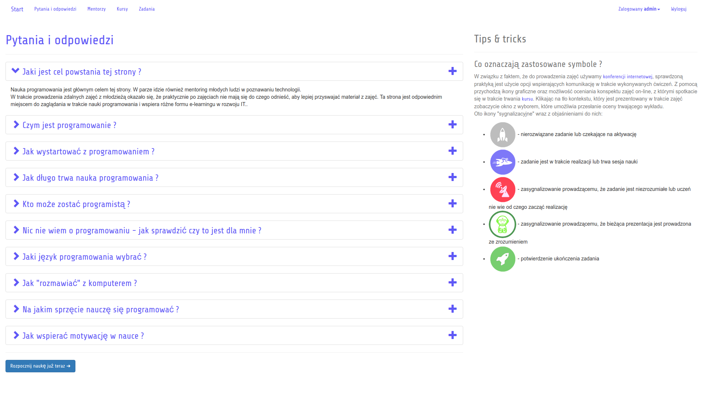
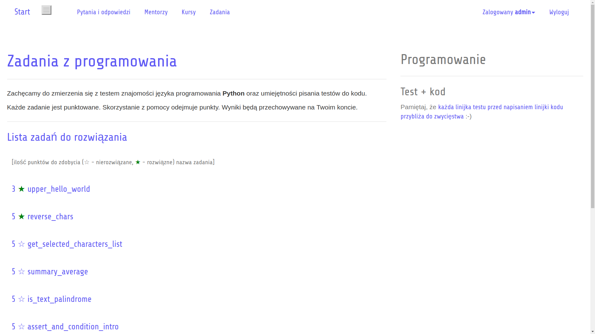
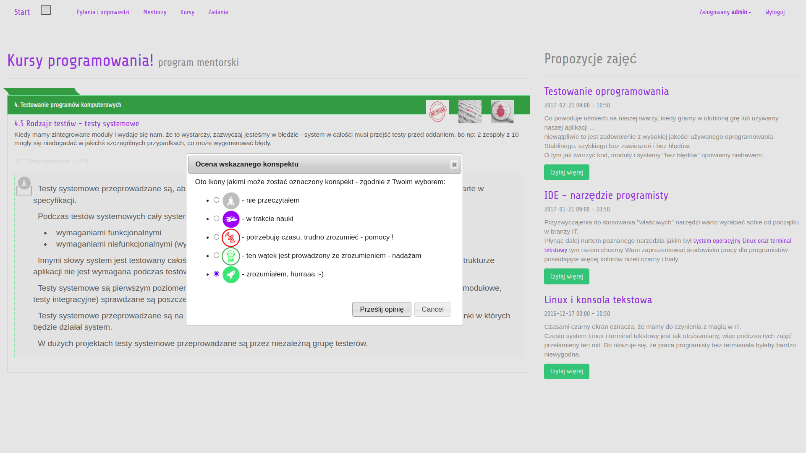

🇬🇧 [English version](README.md) | 🇵🇱 **Polski**

# FreeItLessons - mini platforma e-learningowa do nauki IT i podstaw programowania w Pythonie

**W skrócie:** mała strona internetowa do nauki programowania. Mentorzy piszą
kursy i zadania programistyczne, a uczniowie czytają lekcje, oceniają je
i rozwiązują zadania w języku [Python](https://python.org) prosto w przeglądarce -
strona sama sprawdza rozwiązanie i podpowiada, gdy coś nie wychodzi. Całość
możesz uruchomić na swoim komputerze w kilka minut - zobacz
[Uruchom projekt na swoim komputerze](#uruchom-projekt-na-swoim-komputerze-krok-po-kroku).

Mini platforma e-learningowa z systemem zarządzania treścią (CMS) i możliwością pracy zdalnej łączy prowadzących zajęcia z ich uczniami. Powstała w odpowiedzi na rosnące zainteresowanie uczniów podczas wolontariackich spotkań poświęconych nauce programowania w szkołach i daje elastyczne, przyjazne środowisko do nauki.

Platforma pełni rolę internetowego łącznika pomiędzy comiesięcznymi spotkaniami na żywo, dzięki czemu nauka nie kończy się wraz z wyjściem z klasy. Uczniowie mogą korzystać z materiałów w domu, we własnym tempie i w dogodnym dla siebie czasie.

Najważniejsza jest tu wartość edukacyjna. Dzięki wbudowanemu systemowi e-learningowemu prowadzący mogą uczyć programowania w [języku Python](https://python.org) na praktycznych przykładach. Moduł zadań programistycznych sprawdza rozwiązania testami jednostkowymi i podsuwa wskazówki, więc zachęca do aktywnej pracy i ciągłego doskonalenia się. Dzięki podpowiedziom i interaktywnym funkcjom projekt wykracza poza schemat „napisz i zapomnij” i sprawia, że nauka jest ciekawsza.


## Funkcje
- strona powitalna
- strona z pytaniami i odpowiedziami (FAQ, edytowana przez administratora)
- strony kursów - prosty CMS w środku (edytowany przez administratora)
- zadania programistyczne z automatycznym sprawdzaniem rozwiązań online - moduł kursu online (edytowany przez administratora)
- podstrona o mentorach
- uczniowie oceniają treści kursu (okienko po kliknięciu w tekst lekcji - informacja zwrotna dla prowadzących)

[Zrzuty ekranu](#zrzuty-ekranu) znajdziesz na dole tej strony.


## Uruchom projekt na swoim komputerze (krok po kroku)

**Nie musisz** instalować Pythona, bazy danych ani niczego innego z tego
projektu. Potrzebujesz tylko jednego programu: **Docker Desktop**. Uruchamia on
całą stronę w gotowym „pudełku” (tzw. *kontenerze*) na Twoim komputerze.

**Potrzebujesz:** Windows 10/11 (64-bitowy), macOS (procesor Intel albo Apple
M1/M2/M3/M4) lub Linux, około 4 GB pamięci RAM, 3 GB wolnego miejsca na dysku
i internetu (tylko przy pierwszym uruchomieniu).

> 💡 Jeśli do instalowania programów potrzebne jest hasło administratora
> komputera, poproś o pomoc rodzica albo nauczyciela.

### Krok 1 - zainstaluj Docker Desktop

1. Wejdź na <https://www.docker.com/products/docker-desktop/> i pobierz Docker
   Desktop dla swojego systemu:
   * **Windows:** uruchom instalator i zostaw domyślne ustawienia (Docker korzysta
     z *WSL 2*; jeśli Windows poprosi o zainstalowanie lub aktualizację WSL,
     zgódź się i uruchom komputer ponownie).
   * **macOS:** wybierz *Apple Silicon* (M1/M2/M3/M4) albo *Intel chip* - który masz,
     sprawdzisz w menu Apple → *Ten Mac* (lub *Informacje o tym Macu*).
     Przeciągnij Dockera do folderu *Programy* (*Applications*).
   * **Linux:** zainstaluj *Docker Desktop for Linux* albo *Docker Engine*
     z dodatkiem *Compose* (<https://docs.docker.com/engine/install/>).
2. Uruchom Docker Desktop i poczekaj, aż pokaże, że działa (**running**) -
   ikonka wieloryba 🐳 na pasku zadań / pasku menu przestanie się ruszać.
   Zakładanie konta w Dockerze możesz pominąć (*Skip*).

### Krok 2 - pobierz projekt

Wybierz **jeden** sposób:

* **Najprościej:** na stronie projektu na GitHubie kliknij zielony przycisk
  **Code** → **Download ZIP**, a potem rozpakuj pobrany plik ZIP, np. do folderu
  *Dokumenty*.
* **Przez git** (jeśli go znasz): `git clone https://github.com/bieli/FreeItLessons.git`

Masz teraz folder `FreeItLessons` (albo `FreeItLessons-master`, jeśli pobrałeś ZIP).

### Krok 3 - otwórz terminal w tym folderze

*Terminal* to okno, w którym wpisuje się polecenia.

* **Windows:** otwórz folder projektu w Eksploratorze plików, kliknij prawym
  przyciskiem myszy w puste miejsce → **Otwórz w terminalu** (w starszych
  Windowsach: wpisz `powershell` w pasku adresu okna folderu i naciśnij Enter).
* **macOS:** otwórz aplikację **Terminal** (⌘ + Spacja, wpisz *Terminal*), wpisz
  `cd ` (ze spacją na końcu), przeciągnij folder projektu do okna terminala
  i naciśnij Enter.
* **Linux:** kliknij prawym przyciskiem w folderze → **Otwórz w terminalu**.

Sprawdź, czy jesteś we właściwym miejscu: wpisz `ls` (macOS/Linux) albo `dir`
(Windows) i naciśnij Enter - powinieneś zobaczyć pliki takie jak `README.md`
i `docker-compose.yml`.

### Krok 4 - uruchom stronę

Wpisz to polecenie i naciśnij Enter:

```bash
docker compose up --build
```

Za pierwszym razem wszystko się pobiera i przygotowuje - może to potrwać
**5-15 minut**. Przewinie się dużo tekstu; to normalne. Strona jest gotowa,
gdy zobaczysz linijkę kończącą się tak:

```
[INFO] Listening at: http://0.0.0.0:8000 (1)
```

Nie zamykaj tego okna terminala - zamknięcie go wyłącza stronę.
Kolejne uruchomienia trwają już tylko kilka sekund.

### Krok 5 - otwórz stronę w przeglądarce

Otwórz **<http://127.0.0.1:8000>** w przeglądarce (Chrome, Firefox, Edge, Safari).
🎉 Powinieneś zobaczyć stronę główną FreeItLessons z przykładowymi kursami i zadaniami.

Strona działa tylko na **Twoim** komputerze - inne osoby w Twojej sieci ani
w internecie nie mogą jej otworzyć.

### Krok 6 - załóż swoje konto

Żeby rozwiązywać zadania i zarządzać stroną, musisz się zalogować. Otwórz
**drugie** okno terminala w tym samym folderze (zobacz krok 3) i uruchom:

```bash
docker compose exec web python manage.py createsuperuser
```

Polecenie zapyta (po angielsku) o nazwę użytkownika (*Username*), adres e-mail
(*Email address* - możesz po prostu nacisnąć Enter) i dwa razy o hasło
(*Password* - podczas wpisywania hasła nie widać liter, to normalne).
Jeśli hasło jest zbyt proste, pojawi się pytanie *„Bypass password validation
and create user anyway?”* - do ćwiczeń w domu możesz odpowiedzieć `y`.

Teraz kliknij na stronie **Zaloguj się** i użyj nowego konta.

### Krok 7 - wyłącz stronę

* W terminalu z kroku 4 naciśnij **Ctrl + C** (na macOS też: **Control + C**) albo
* wpisz `docker compose down` w dowolnym terminalu w folderze projektu.

Wszystko, co zrobisz (konta, rozwiązane zadania, oceny), zostaje zapisane i będzie
dostępne przy następnym `docker compose up`. Żeby zacząć od nowa z przykładowymi
danymi, uruchom `docker compose down -v` (⚠️ to usuwa Twoje konta i postępy).


## Pierwsze kroki na platformie

| Co wypróbować | Gdzie |
|---|---|
| Przeczytaj kurs i oceń lekcję: kliknij w tekst lekcji i wybierz ikonkę | **Kursy** → rozdział |
| Rozwiąż zadanie w Pythonie: napisz kod w edytorze, kliknij **Uruchom program**, a gdy utkniesz - użyj żółtych przycisków z podpowiedziami | **Zadania** (po zalogowaniu) |
| Zobacz swoje punkty | Twoja nazwa w górnym menu → **Osiągnięcia** |
| Dodawaj i zmieniaj kursy, zadania, FAQ, mentorów (jako administrator) | <http://127.0.0.1:8000/admin/> |

**Konta dla uczniów:** administrator dodaje kolejne konta na stronie
<http://127.0.0.1:8000/admin/auth/user/add/>. Po zapisaniu zaznacz
**„W zespole”** i kliknij **Zapisz** - uczniowie logują się przez tę samą stronę
logowania co administratorzy, więc to pole musi być zaznaczone.
Nie zaznaczaj uczniom pola **„Status superużytkownika”**.

**Przykładowa baza danych** zawiera już konta (np. `admin`). Ich hasła nie są
publiczne - jeśli chcesz z nich korzystać, ustaw nowe hasło:

```bash
docker compose exec web python manage.py changepassword admin
```


## Rozwiązywanie problemów

| Problem | Co zrobić |
|---|---|
| `docker: command not found` / *'docker' is not recognized* | Docker Desktop nie jest zainstalowany albo nie jest włączony. Uruchom go, poczekaj, aż zacznie działać, i otwórz **nowe** okno terminala. |
| *Cannot connect to the Docker daemon* / *error during connect* | Docker Desktop jeszcze się nie uruchomił - włącz go i poczekaj, aż ikonka wieloryba przestanie się ruszać. |
| *no configuration file provided: not found* | Terminal nie jest otwarty w folderze projektu - powtórz krok 3. |
| *port is already allocated* / *address already in use* | Port 8000 zajmuje inny program. Wyłącz go albo w pliku `docker-compose.yml` zmień `"127.0.0.1:8000:8000"` na `"127.0.0.1:8001:8000"` i otwórz <http://127.0.0.1:8001>. |
| Przeglądarka pokazuje *Nie można uzyskać dostępu do tej witryny* | Poczekaj, aż w terminalu pojawi się `Listening at` (krok 4), i odśwież stronę. |
| *the input device is not a TTY* (Windows, Git Bash) | Polecenia `docker compose exec ...` uruchamiaj w PowerShellu albo w Terminalu Windows. |
| Pierwsze uruchomienie trwa bardzo długo albo przerywa się przy pobieraniu | Sprawdź połączenie z internetem i uruchom ponownie `docker compose up --build` - pobieranie będzie kontynuowane. |
| Zmieniłeś pliki projektu i nie widzisz zmian | Wyłącz stronę i uruchom ją poleceniem `docker compose up --build`. |
| Na Linuksie: *permission denied ... docker.sock* | Uruchamiaj polecenia z `sudo` albo dodaj się do grupy `docker` (`sudo usermod -aG docker $USER`, potem wyloguj się i zaloguj ponownie). |

Nowszą wersję projektu dostaniesz, pobierając go ponownie (albo przez `git pull`)
i uruchamiając `docker compose up --build`.


## Zrzuty ekranu

---


---


---


---


---


---

---


## Dla programistów

Technologie: **Python 3.12+**, **Django 6.1**, SQLite, interfejs w **React 19**
budowany przez Vite (`frontend/`), Docker / Docker Compose.

### Docker Compose

```bash
docker compose up --build                # http://127.0.0.1:8000 (przykładowa baza kopiowana do wolumenu)
docker compose run --build --rm tests    # lint + testy Django + kontrole Django
docker compose run --rm frontend-tests   # testy jednostkowe Reacta + build produkcyjny
make regression                          # stara wersja (Py3.7/Django 1.11) vs obecna: testy charakteryzacyjne (HTTP)
make regression-ui                       # gałąź z interfejsem jQuery vs obecna: kontrakt serwera (HTTP)
make e2e                                 # testy w przeglądarce: interfejs jQuery (gałąź bazowa) vs React
```

### Bez Dockera (virtualenv + Node)

Wymaga Pythona 3.12+ i Node.js 22+ (`make` jest dostępny na Linuksie i macOS;
na Windowsie uruchom ręcznie polecenia z pliku [`Makefile`](Makefile)).

```bash
make install-dev          # python3.12 -m venv .venv + zależności deweloperskie (requirements.dev.lock)
make lock                 # po zmianie requirements*.txt: odtwarza pliki *.lock z hashami (wymaga uv)
. .venv/bin/activate
make frontend-install     # zależności interfejsu React (frontend/)
make chpwd                # opcjonalnie: zmiana hasła użytkownika "admin"
make run                  # buduje paczkę Reacta, DJANGO_DEBUG=1 runserver na http://127.0.0.1:8000
make frontend-dev         # (drugi terminal) przebudowuje paczkę Reacta po każdej zmianie
make ci                   # pycodestyle + testy Django
make frontend-test        # testy jednostkowe Reacta
```

### Konfiguracja (zmienne środowiskowe)

| Zmienna | Domyślnie | Znaczenie |
|---|---|---|
| `DJANGO_SECRET_KEY` | — (**wymagana**, chyba że `DJANGO_DEBUG=1`) | tajny klucz |
| `DJANGO_DEBUG` | `0` | tryb debugowania, nigdy nie włączaj go na produkcji |
| `DJANGO_ALLOWED_HOSTS` | `127.0.0.1,localhost` | nazwy hostów oddzielone przecinkami |
| `DJANGO_CSRF_TRUSTED_ORIGINS` | — | np. `https://elearning.example.com` |
| `DJANGO_DB_PATH` | `./db.sqlite3` (`/data/db.sqlite3` w Dockerze) | plik bazy SQLite |
| `DJANGO_SECURE_COOKIES`, `DJANGO_SECURE_SSL_REDIRECT`, `DJANGO_SECURE_HSTS_SECONDS`, `DJANGO_BEHIND_TLS_PROXY` | wyłączone | zabezpieczenia HTTPS - włącz, gdy strona działa przez TLS |
| `CODE_RUN_TIMEOUT_SECONDS` / `CODE_RUN_MEMORY_MB` / `CODE_RUN_OUTPUT_KB` | `5` / `256` / `256` | limity jednego uruchomienia programu ucznia |

Ustawienia domyślne w `docker-compose.yml` są przeznaczone tylko dla komputera
lokalnego. Na publicznym serwerze ustaw własne `DJANGO_SECRET_KEY`,
`DJANGO_ALLOWED_HOSTS` oraz zmienne HTTPS.

### Uwagi o aktualizacji (Python 3.12 + Django 6.1)

Projekt przeniesiono z Django 1.11 w dwóch krokach; każdy z nich sprawdzono
narzędziem do testów charakteryzacyjnych z katalogu [`regression/`](regression/README.pl.md)
(stara i nowa aplikacja przechodzą te same scenariusze na identycznych bazach
danych, a odpowiedzi i powstałe dane są porównywane):

1. **Aktualizacja z zachowaniem działania** - API frameworka, zależności,
   początkowa migracja (istniejąca baza przyjmuje ją bez zmian), Docker.
   Jedyna zamierzona zmiana: wylogowanie odbywa się przez POST (Django 5+
   nie obsługuje wylogowania przez GET).
2. **Poprawki bezpieczeństwa** - każda zamierzona zmiana działania jest opisana
   wraz z powodem w pliku [`regression/expected_differences.json`](regression/expected_differences.json):
   * programy uczniów działają w ograniczonym procesie interpretera (bez powłoki,
     z pustym środowiskiem, limitem czasu, CPU, pamięci, plików i procesów oraz
     „audit hookiem” blokującym procesy, sieć, kod natywny i dostęp do plików);
     testy zawsze pochodzą z bazy danych, nigdy z przeglądarki,
   * kodu źródłowego aplikacji nie da się już pobrać spod `/static/`,
   * zmiana stanu przez AJAX (ocena treści) to POST z tokenem CSRF,
   * brak tajnego klucza w repozytorium, `DEBUG` domyślnie wyłączony,
     ustawienia HTTPS przez zmienne środowiskowe,
   * walidacja danych wejściowych (koniec z błędami HTTP 500 przy niepoprawnych
     żądaniach), zapytania SQL z parametrami,
   * skrypty ładowane tylko przez https, nieużywane skrypty zewnętrzne usunięte.

Wysyłane programy są dekodowane jako UTF-8 (polskie litery są dozwolone);
dane, które nie są poprawnym UTF-8 (dawna strona z jQuery), są odczytywane jako latin-1.

Znane ograniczenia i zalecenia: uruchamianie kodu to kilka warstw zabezpieczeń,
a nie szczelne więzienie (sandbox) - jeśli z platformy korzystają nieznane osoby
z internetu, uruchom ją dodatkowo w piaskownicy systemowej (gVisor/nsjail albo
osobny kontener bez dostępu do bazy danych). Uczniowie logują się przez stronę
logowania panelu administracyjnego Django, więc potrzebują `is_staff`; nie
nadawaj im żadnych uprawnień do modeli w panelu.

### Interfejs (React)

Interaktywne części stron to komponenty Reacta („wyspy”), budowane przez Vite
z katalogu [`frontend/`](frontend/README.pl.md) do `mainapp/static/mainapp/dist/`
(obraz Dockera buduje je w etapie z Node). Strony, adresy URL i treści nadal
generuje Django; element taki jak `<div data-island="FaqAccordion"
data-props-id="faq-props">` przejmuje komponent o tej nazwie, który dostaje dane
przez `json_script`.

| Wyspa | Strona | Zastępuje |
|---|---|---|
| `NavBar` | każda strona | Bootstrap 3 JS (rozwijane menu) + jQuery |
| `FaqAccordion` | FAQ | rozwijane odpowiedzi w jQuery |
| `RotatingStatusIcons`, `FloatingBackground` | strona główna | animacje jQuery, floating.js |
| `ContentBlock` + `OpinionDialog` | rozdział kursu | okno dialogowe jQuery UI, AJAX w jQuery |
| `TaskWorkspace` (ładowany na żądanie) | zadanie | edit_area, highlight.js, jquery.base64, easytimer, AJAX w jQuery |
| `StatusPieChart` (`admin.js`) | panel: statusy treści | skrypt z jQuery + Google Charts |

Ten sam zestaw testów Playwright ([`e2e/`](e2e/README.pl.md)) działa na dawnym interfejsie
jQuery i na interfejsie React, więc zgodność funkcji jest sprawdzana
w prawdziwej przeglądarce (`make e2e`); znane błędy interfejsu jQuery są tam
oznaczone jako oczekiwane niepowodzenia.

### Vagrant (stare, nieutrzymywane)

Skrypty z katalogu [`vagrant/`](vagrant/) tworzą maszynę wirtualną z Ubuntu 16.04
i Dockerem; powstały dla starej wersji z Django 1.11 i nie są testowane z obecną
wersją. Zalecany sposób to Docker Desktop (zobacz
[Uruchom projekt na swoim komputerze](#uruchom-projekt-na-swoim-komputerze-krok-po-kroku)).
W dowolnej maszynie wirtualnej z Linuksem, Dockerem i dodatkiem Compose polecenie
`docker compose up --build` w folderze projektu działa tak samo.


## Do zrobienia (TODO)
- [x] scalenie pierwszych pull requestów
- [x] README ze zrzutami ekranu
- [x] obraz Vagranta (z kontenerem Dockera) - gotowe środowisko dla innych programistów
- [x] aktualizacja Dockerfile do Pythona 3.5 + instrukcja
- [ ] tłumaczenia w panelu administracyjnym i wszystkich komunikatach systemu
- [ ] wybór języka strony
- [ ] przejście na nowy system szablonów Bootstrapa
- [x] przejście z jQuery na nowoczesny JavaScript lub VueJS itp. (React)
- [ ] rozmiary czcionek dopasowane do ekranu (obecnie są za małe dla oczu)
- [ ] tabele wyników (ciekawe funkcje dla całej klasy - wyzwania dla klas itp.)
- [x] przejście na najnowsze Django + aktualizacja komponentów Django
- [x] aktualizacja pakietów i poprawki ciekawych problemów bezpieczeństwa :-)
- [ ] opisy zrzutów ekranu
- [ ] więcej informacji o funkcjach (może film na YouTube!)
- [ ] przeniesienie zadań do osobnych modułów z testami jednostkowymi
- [x] testy jednostkowe i CI (GitHub Actions)
